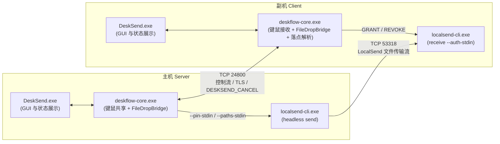

  
  <h1>DeskSend</h1>
  
<strong>在多台 Windows 电脑之间共享同一套键鼠，并直接把文件拖过屏幕边缘送到另一台电脑。</strong>

  

    
    
  

  

    <a href="https://github.com/wtyLaziness/desksend/releases/latest">下载最新完整包</a> ·
    <a href="docs/使用指南.md">详细使用指南</a> ·
    <a href="docs/构建与发布.md">构建与发布</a> ·
    <a href="docs/发布与更新.md">发布与更新说明</a> ·
    <a href="LICENSE.md">许可证</a>
  

---

**DeskSend** 将 [Deskflow](https://github.com/deskflow/deskflow) 的跨屏键鼠共享与 [LocalSend](https://github.com/localsend/localsend) 的局域网文件传输整合在统一桌面界面与绿色便携包中。用户无需单独启动 LocalSend，也无需手动配对传输客户端，即可通过习惯的系统拖拽手势完成跨机文件发送。

## 核心特性

| 能力 | 说明 |
| --- | --- |
| **原生跨屏拖拽传文件** | 在主机（Server）桌面或资源管理器拖起文件或文件夹，越过屏幕边缘并在副机（Client）松手即传；传输开始后可将鼠标移回主机继续操作。 |
| **智能落点与剪贴板回退** | 落在副机桌面或打开的资源管理器窗口/当前标签页时直写对应目录；落在其他应用窗口时保存到默认接收目录（优先“下载”，其次“桌面”），并同步写入系统文件剪贴板供 `Ctrl+V` 粘贴。 |
| **可取消、不混传** | 松手前按 `Esc` 或将鼠标拖回主机即可取消，不触发传输且保留主机源文件；每次拖拽绑定独立一次性会话令牌与 SHA-256 截断标签（`pin_tag`），支持按会话精准取消。 |
| **传输隔离与安全控制** | 键鼠通道（`TCP 24800`）支持 TLS 加密与证书指纹信任；文件组件（`TCP 53318`）通过标准输入（`--auth-stdin` / `--pin-stdin` / `--paths-stdin`）传递一次性令牌和路径清单，避免密钥和文件路径暴露在命令行或日志中。 |
| **一体便携与安全升级** | 解压即用，支持菜单“帮助 → 检查 DeskSend 更新”。下载后核对大小与 `SHA-256`、支持 GitHub `ETag` 缓存与传输中安装二次确认，更新时备份旧程序至 `.desksend-backups/` 并完整保留 `settings/`。 |

---

## 工作原理与架构

DeskSend 在运行时协调桌面界面、键鼠共享核心以及后台 LocalSend 文件收发组件协同工作：

| 组件 / 端口 | 职责说明 |
| --- | --- |
| `DeskSend.exe` | 桌面主界面、托盘、系统设置与内建更新器。 |
| `deskflow-core.exe` | 跨屏键鼠核心与 `FileDropBridge`（捕获拖拽、分发授权令牌、解析副机落点并触发文件回退）。 |
| `localsend-cli.exe` | 随包附带的后台 LocalSend 文件发送/接收进程，由核心按需拉起，无需手动运行。 |
| `TCP 24800` | 主机默认键鼠共享及 DeskSend 控制信令端口（需主机入站放行）。 |
| `TCP 53318` | 副机默认 `localsend-cli` 接收端口（需副机入站放行）。 |

> 部分内部二进制名、配置文件路径与常量（如 `deskflow-core.exe`、`settings/Deskflow.conf`、`settings/tls/`、`kOrgDomain`）保留 Deskflow 名称，用于维持便携模式检测与历史配置兼容性，请勿手动改名。

---

## 快速开始（Windows x64）

### 1. 下载与解压

1. 前往 [GitHub Releases](https://github.com/wtyLaziness/desksend/releases/latest)（应用内更新通道对应 [desksend-releases](https://github.com/wtyLaziness/desksend-releases/releases/latest)）下载 **`DeskSend-<版本>-windows-x64.zip`**。
2. 将压缩包**完整解压到一个可写目录**，再运行 **`DeskSend.exe`**。
3. 切勿在压缩包预览中直接运行，也不要单独复制 EXE；请保留同目录下的 `localsend-cli.exe`、`deskflow-core.exe`、Qt DLL、插件与 `translations/`。`DeskSend-<版本>-source.zip` 为对应版本的源码归档。

### 2. 配置主机与副机

两台 Windows 电脑接入同一可互访局域网，并使用相同版本：

1. **主机（Server，连接物理键鼠的电脑）**：
   - 打开 `DeskSend.exe`，选择“使用此计算机的键盘和鼠标”。
   - 进入“配置服务器”，添加副机屏幕并按实际方位放置，屏幕名称需与副机界面显示的计算机名一致。
   - 点击启动。若开启防火墙，放行入站 **`TCP 24800`**。
2. **副机（Client）**：
   - 打开 `DeskSend.exe`，选择“使用另一台计算机的鼠标和键盘”。
   - 填入主机的局域网 IPv4 地址（切勿填写 `127.0.0.1`）并启动。放行入站 **`TCP 53318`**。
3. **完成配对**：首次启用 TLS 连接出现证书指纹确认时，请核对两端指纹一致后再信任；随后将鼠标移过配置好的屏幕边缘验证跨屏操作。

### 3. 跨屏传输文件

1. 在主机桌面或资源管理器中选中一个或多个文件/文件夹，按住鼠标左键拖动。
2. 拖向副机所在方向的屏幕边缘，跨屏进入副机桌面或已打开的资源管理器文件夹窗口后松手。
3. DeskSend 自动完成传输并在界面显示进度与结果；源文件仍保留在主机。开始传输后即可把鼠标移回主机继续操作。

常见异常排查与详细说明（端口测试、落点规则、语言设置、防火墙建议）请见 [详细使用指南](docs/使用指南.md)。

---

## 更新与配置保留

- **应用内更新**：点击菜单 **“帮助 → 检查 DeskSend 更新”**（英文界面为 `Help → 检查 DeskSend 更新…`），下载校验通过后点击 **“安装并重启”**。程序会在退出后复核 ZIP 哈希与 `desksend-build.json` 文件清单、将待覆盖文件备份至 `.desksend-backups/`，并完整保留 `settings/`（配置、证书、信任指纹）。
- **手动升级或换目录迁移**：
  1. 等待文件传输完成后退出旧版 DeskSend。
  2. 将新版 `DeskSend-<版本>-windows-x64.zip` 完整解压到新目录。
  3. 将旧目录中的整个 **`settings/` 文件夹** 复制到新目录，覆盖新包默认配置。
  4. 运行新目录的 `DeskSend.exe`（若安装路径变化，注意同步更新防火墙允许规则）。

更新协议与回滚细节见 [发布与更新说明](docs/发布与更新.md)。

---

## 当前能力边界

- **运行平台与形态**：目前仅提供 **Windows x64 绿色便携版**。便携版不安装系统服务，因此无法接管 Windows 登录界面、锁屏或 UAC 安全桌面。
- **拖拽传输方向**：当前仅支持 **主机（Server）→ 副机（Client）** 方向的跨屏文件拖拽传输。
- **空目录处理**：保留多级嵌套目录结构，但纯空文件夹或空子目录会被忽略，不会在目标端创建空目录。
- **离线/重启重连**：主机关闭或重启后，保持运行的副机将自动等待重连（包含 mTLS 重连）。

---

## 仓库结构与开发者入口

| 路径 | 内容 |
| --- | --- |
| [`deskflow-master/`](deskflow-master/) | DeskSend GUI、`deskflow-core`、跨屏拖拽桥接 `FileDropBridge`、内建更新器与版本定义 [`DeskSendVersion.cmake`](deskflow-master/cmake/DeskSendVersion.cmake)。 |
| [`localsend-main/`](localsend-main/) | 精简后的 Rust 工作区，仅保留后台文件收发进程 [`cli/`](localsend-main/cli/) 与 LocalSend 协议实现 [`packages/core/`](localsend-main/packages/core/)。 |
| [`scripts/`](scripts/) | 完整发布包、对应源码归档与 `SHA256SUMS.txt` 组装脚本 [`package-release.py`](scripts/package-release.py)。 |
| [`docs/`](docs/) | [使用指南](docs/使用指南.md)、[构建与发布说明](docs/构建与发布.md) 与 [发布与更新说明](docs/发布与更新.md)。 |
| [`.github/workflows/`](.github/workflows/) | `deskflow-win`（C++ 构建/单测与打包）与 `localsend-cli-win`（Rust 构建/单测与打包）。 |

想从源码构建或打包发布，请先阅读 [构建与发布](docs/构建与发布.md)。

---

## 许可证与致谢

- **Deskflow 键鼠共享核心、GUI 及对应修改**：`GPL-2.0-only WITH LicenseRef-OpenSSL-Exception`（[GPLv2](deskflow-master/LICENSE)、[OpenSSL 链接例外](deskflow-master/LICENSES/LicenseRef-OpenSSL-Exception.txt)）
- **LocalSend 文件传输组件及对应修改**：`Apache-2.0`（[LocalSend LICENSE](localsend-main/LICENSE)）
- **构建与发布脚本**：按各文件头部 SPDX 声明或上游原始许可提供，完整许可说明见 [许可证索引](LICENSE.md)。
